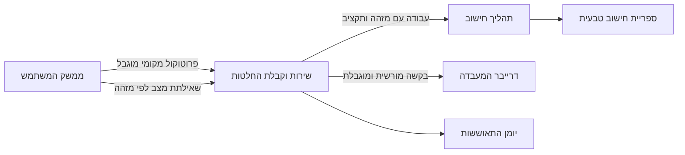

# ארכיטקטורה עם גבולות ברורים

נניח שהחלון שולח עבודה לשירות, השירות מפעיל מנוע C++, והמנוע משתמש בdriver. המשתמש סגר את החלון באמצע. מי מבטל את העבודה, מי משחרר את הbuffer ומי רשאי להגיד שהיא הצליחה?

הקוד של כל רכיב יכול להיות תקין לבדו, ובכל זאת התשובות לא יתאימו זו לזו. בפרויקט הגמר נתחיל מהגבולות האלה לפני שנוסיף עוד כפתור. הארכיטקטורה שלנו צריכה להסביר מה עובר בין הרכיבים ומה נשאר בבעלות כל אחד.

## בוחרים גבול לפי סיבה

הממשק רץ בזהות המשתמש ומציג מצב. השירות מחזיק את מדיניות קבלת העבודה ואת הjournal. ספריית החישוב רצה בתהליך worker מוגבל כאשר כשל שלה צריך להיות מבודד מהשירות. הdriver נותן יכולת שבאמת דורשת את גבול הקרנל שבנינו בפרק 13, ומקבל ממשק קטן ומוגבל.

התרשים הבא מתאר את הכיוון של בקשה אחת. החצים אינם מעבירים pointer גולמי בין תהליכים.



החלוקה הזאת מאפשרת לשירות לשרוד סגירת חלון. היא גם מאפשרת לו לדחות עבודה לפני הקצאת משאבים יקרים. אם אין צורך אמיתי בdriver במוצר שבחרתם, שומרים את מעבדת הדרייבר כנספח נפרד ומנמקים את ההחלטה; לא מעבירים parser מורכב לקרנל כדי שהתרשים ייראה מתקדם.

## זהות אינה שדה שהלקוח בוחר

הclient יכול לשלוח request ID, אך הוא אינו רשאי לשלוח SID ולקבל אמון רק מפני שהמחרוזת נראית תקינה. זהות המתקשר מגיעה ממנגנון ההזדהות של הtransport, כמו scoped impersonation של named pipe מפרק 8. המזהה של פעולה הוא שילוב של זהות אמינה ומזהה בקשה.

המודל הבא מדגים את ההחלטה אחרי שהtransport כבר אימת את זהות הpeer. הוא אינו מבצע authentication בעצמו. המפה מוגבלת כדי להראות שגם deduplication צורך זיכרון וצריך חוזה retention.

```cpp
#include <cassert>
#include <cstdint>
#include <map>
#include <string>
#include <utility>

struct TrustedPeer { std::string principal; bool may_submit; };
struct Request { unsigned version; std::uint64_t id; std::uint32_t amount; };
enum class Reply { accepted, duplicate, denied, bad_version, bad_input, conflict, full };
class Admission {
    std::map<std::pair<std::string,std::uint64_t>, std::uint32_t> requests;
public:
    Reply submit(const TrustedPeer& peer, Request request) {
        if (!peer.may_submit) return Reply::denied;
        if (request.version != 1) return Reply::bad_version;
        if (request.id == 0 || request.amount > 1000000) return Reply::bad_input;
        auto key = std::make_pair(peer.principal, request.id);
        auto found = requests.find(key);
        if (found != requests.end())
            return found->second == request.amount ? Reply::duplicate : Reply::conflict;
        if (requests.size() >= 64) return Reply::full;
        requests.emplace(std::move(key), request.amount);
        return Reply::accepted;
    }
};
int main() {
    Admission service;
    TrustedPeer alice{"alice",true}, bob{"bob",true}, guest{"guest",false};
    assert(service.submit(alice,{1,7,20}) == Reply::accepted);
    assert(service.submit(alice,{1,7,20}) == Reply::duplicate);
    assert(service.submit(alice,{1,7,21}) == Reply::conflict);
    assert(service.submit(bob,{1,7,20}) == Reply::accepted);
    assert(service.submit(guest,{1,8,20}) == Reply::denied);
    assert(service.submit(alice,{2,8,20}) == Reply::bad_version);
}
```

המודל מסביר למה מזהה זהה עם payload אחר אינו retry תקין. הוא מסביר גם למה שני משתמשים יכולים לבחור אותו מספר בלי להפוך לאותה פעולה. במערכת אמיתית הjournal צריך לשמר את הקשר הזה לאורך פרק הזמן שבו השרת מבטיח deduplication.

## בעלות שחוצה runtime

הגבול בין C# לC++ משתמש בC ABI מפרק 12. הגודל, הגרסה והמשמעות של כל שדה מתועדים. הספרייה אינה זורקת C++ exception אל קוד מנוהל, והcallback המנוהל אינו נותן לexception לחצות בחזרה גבול native.

הפעולה האסינכרונית מחזיקה context עד שהספרייה מאשרת quiescence. סיום חלון מסיר subscriptions ומבקש ביטול, אבל אינו משחרר context שcallback מאוחר עדיין יכול לקבל. זאת אותה בעיית חיים שפגשנו בCOM, בIOCP ובמסננים, רק עם שני מנגנוני זיכרון באותה תמונה.

## כשל הוא חלק מהממשק

נכתוב ליד כל פעולה ארבע תשובות אפשריות: לא התקבלה, התקבלה ונמצאת בעבודה, הסתיימה, או שתוצאתה כרגע אינה ידועה ללקוח. הtimeout של הclient אינו מוחק את המצב שהשירות כבר שמר. הוא רק אומר שהclient הפסיק להמתין במסלול המסוים הזה.

הפרוטוקול מאפשר query לפי מזהה, cancellation בעל משמעות מוגדרת ותגובה לגרסה שאינה נתמכת. מגבלת גודל נבדקת לפני הקצאה לפי שדה האורך. גרסה חדשה אינה הופכת bytes עודפים לנתונים שמותר לפרש בלי בדיקה.

## סדר הסגירה נגזר מהתלויות

הסגירה מתחילה בעצירת קבלה, ממשיכה בהכרעה לגבי עבודות פעילות ומסתיימת בפריקת callbacks ומשאבים. אם הservice מפסיק לענות לפני שהworker הצליח למסור completion, צריך ערוץ חלופי או כלל recovery שמסביר מה יקרה. אם הUI מחכה באופן חוסם להמשך שצריך לרוץ בdispatcher שלו, נוצר מעגל המתנה.

ההגשה של השיעור היא תרשים בעלות לצד תרשים התקשורת. ליד כל קו מציינים מי רשאי לקרוס, מה נשאר אחריו ואיך הצד השני מגלה את המצב. זהו מסמך שמאפשר לכתוב את הקוד, וגם לבדוק שהוא עדיין מתאים לתכנון אחרי שינוי.
